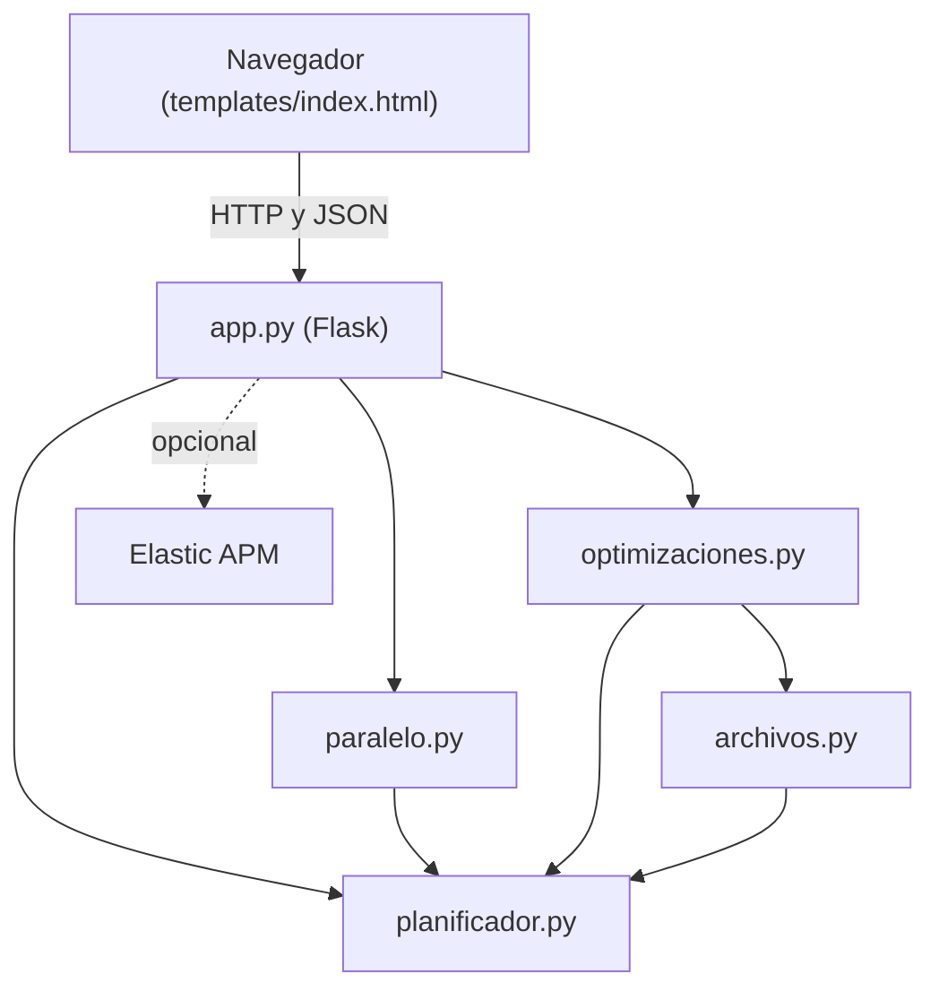

# Arquitectura

## Diagrama de componentes

## Módulos y responsabilidades

| Módulo | Responsabilidad |
|---|---|
| `planificador.py` | Orden, niveles, cronograma, duración, memoización y caché |
| `paralelo.py` | Ejecutar tareas en varios procesos con `Queue` |
| `archivos.py` | Escribir y leer archivos grandes con buffer y lotes |
| `optimizaciones.py` | Cada paso del planificador con y sin su optimización |
| `app.py` | Interfaz web y validación de los datos que llegan |
| `parcial2.py` | Mediciones por consola, comparadas contra el Parcial 1 |
| `perfilar.py` | Programa corto para los perfiladores |
| `ci/` | Controles de calidad y eficiencia |

## Dependencias

| Dependencia | Para qué |
|---|---|
| Flask | Interfaz web |
| elastic-apm | Monitoreo de la web (opcional) |
| Biblioteca estándar | `heapq`, `multiprocessing`, `functools`, `typing` |

Las herramientas de desarrollo y todas las versiones exactas están en `requirements-lock.txt`.
