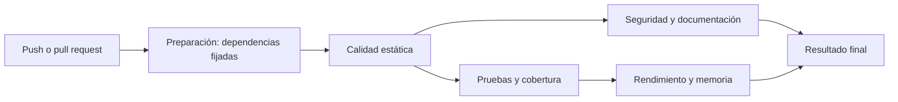

# Controles del CI

El pipeline es `.github/workflows/ci.yml`. Corre en cada push y en cada pull request hacia `main`.

## Etapas

Los controles rápidos corren primero. Pruebas y seguridad corren en paralelo. Las mediciones costosas quedan para el final.

## Matriz de controles

| Control | Herramienta | Comando (`./ci/controles.sh`) | Reporte | Se rechaza si |
|---|---|---|---|---|
| Pruebas | pytest, unittest, doctest | `pruebas` | `pruebas.xml` | Falla una o más pruebas |
| Cobertura | coverage.py | `pruebas` | `cobertura.xml` | Baja de 85 % |
| Benchmark | pytest-benchmark | `rendimiento` | `benchmark.json` | La mediana empeora más de 100 % contra la línea base |
| Profiling de CPU | cProfile | `rendimiento` | `orden_*.prof` | `orden_rapido` no le gana a `orden_lento` |
| Análisis estático | Ruff, Pylint | `estatica` | Consola | Hay un aviso de Ruff o Pylint da menos de 9,5 |
| Complejidad | Radon | `estatica` | `radon.json` | Una función supera 10 |
| Memoria | tracemalloc | `rendimiento` | `memoria.json` | Leer por lotes supera 5 MB |
| Vulnerabilidades | Bandit, pip-audit, Gitleaks | `estatica`, `seguridad` | `bandit.json`, `pip-audit.json`, `gitleaks.sarif` | Según la [política de seguridad](08-seguridad.md) |
| Tipado | mypy | `estatica` | Consola | Hay un error de tipos |
| Dependencias | `requirements-lock.txt`, pip-audit, Dependabot | `seguridad` | `pip-audit.json` | Hay una vulnerabilidad conocida |
| Documentación | Sphinx, markdownlint-cli2, Lychee | `documentacion` | Consola | No se genera, falla el formato o hay un enlace roto |

## Por qué no todos usan el mismo criterio

Las pruebas son deterministas: un fallo es un fallo. Los benchmarks y la memoria varían según el entorno, por eso tienen tolerancia, se comparan contra una línea base medida en el mismo tipo de máquina y usan la mediana de muchas repeticiones.

## Bloqueo de la integración

La rama `main` está protegida: un pull request no se puede integrar si el check **Resultado final** falla.
