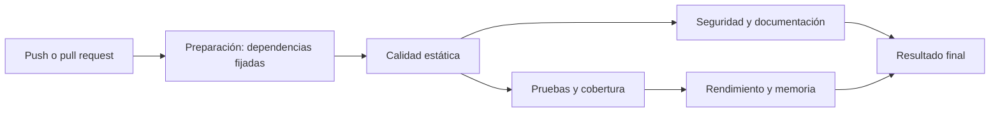

# Controles del CI

El pipeline es `.github/workflows/ci.yml`. Corre en cada push y en cada pull request hacia `main`.

## Etapas

Los controles rápidos corren primero. Pruebas y seguridad corren en paralelo. Las mediciones costosas quedan para el final.

## Matriz de controles

| Control | Herramienta | Comando (`./ci/controles.sh`) | Reporte | Se rechaza si |
|---|---|---|---|---|
| Pruebas | pytest, unittest, doctest | `pruebas` | `pruebas.xml` | Falla una o más pruebas |
| Cobertura | coverage.py | `pruebas` | `cobertura.xml` | Baja de 80 % |
| Benchmark | pytest-benchmark | `rendimiento` | `benchmark.json` | La mediana empeora más de 100 % contra la línea base |
| **Performance Gate** | `ci/escalabilidad.py` | `rendimiento` | `escalabilidad.json` | Ordenar 100.000 tareas tarda 1 s o más (`Performance Gate FAILED`) |
| Build | compileall, Flask | `build` | Consola | El código no compila o la web no planifica |
| Profiling de CPU | cProfile | `rendimiento` | `orden_*.prof` | `orden_rapido` no le gana a `orden_lento` |
| Análisis estático | Ruff, Pylint | `estatica` | Consola | Hay un aviso de Ruff o Pylint da menos de 9,5 |
| Complejidad | Radon | `estatica` | `radon.json` | Una función supera 10 |
| Memoria | tracemalloc | `rendimiento` | `memoria.json` | Leer por lotes supera 5 MB |
| Vulnerabilidades | Bandit, pip-audit, Gitleaks | `estatica`, `seguridad` | `bandit.json`, `pip-audit.json`, `gitleaks.sarif` | Según la [política de seguridad](08-seguridad.md) |
| Tipado | mypy | `estatica` | Consola | Hay un error de tipos |
| Dependencias | `requirements-lock.txt`, pip-audit, Dependabot | `seguridad` | `pip-audit.json` | Hay una vulnerabilidad conocida |
| Documentación | Sphinx, markdownlint-cli2, Lychee | `documentacion` | Consola | No se genera, falla el formato o hay un enlace roto |

## Por qué no todos usan el mismo criterio

Las pruebas son deterministas: un fallo es un fallo. Los benchmarks y la memoria varían según el entorno, por eso tienen tolerancia, se comparan contra una línea base medida en el mismo tipo de máquina y usan la mediana de muchas repeticiones.

## Bloqueo de la integración

La rama `main` está protegida: un pull request no se puede integrar si el check **Resultado final** falla.

## Evidencias

Cada pull request rompe un criterio a propósito y no se integra:

| Pull request | Cambio | Falló en | Motivo |
|---|---|---|---|
| [13](https://github.com/DavidAbril411/planificador-de-tareas/pull/13) | Import sin usar | Code Quality | Ruff F401 |
| [14](https://github.com/DavidAbril411/planificador-de-tareas/pull/14) | Prioridad invertida | Tests | 5 fallidos, 43 exitosos |
| [15](https://github.com/DavidAbril411/planificador-de-tareas/pull/15) | `shell=True` | Code Quality | Bandit B602, severidad alta |
| [16](https://github.com/DavidAbril411/planificador-de-tareas/pull/16) | Heap rearmado en cada paso | Performance | `Performance Gate FAILED` |

## Prueba de regresión de rendimiento

1. Versión eficiente, [pull request 12](https://github.com/DavidAbril411/planificador-de-tareas/pull/12): gate aprobado, 100.000 tareas en 0,242 s.
2. Versión empeorada, [pull request 16](https://github.com/DavidAbril411/planificador-de-tareas/pull/16): agrega al heap y lo rearma entero en cada paso. Las 48 pruebas siguen pasando porque el resultado es correcto, pero 100.000 tareas tardan 14,7 s.
3. El Performance Gate lo detecta, la etapa Performance falla y el pull request queda bloqueado.

Es lo que justifica el gate: ningún otro control detecta una regresión que no cambia el resultado.
